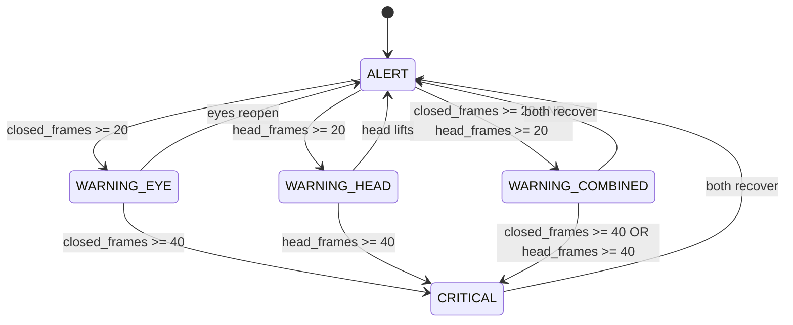
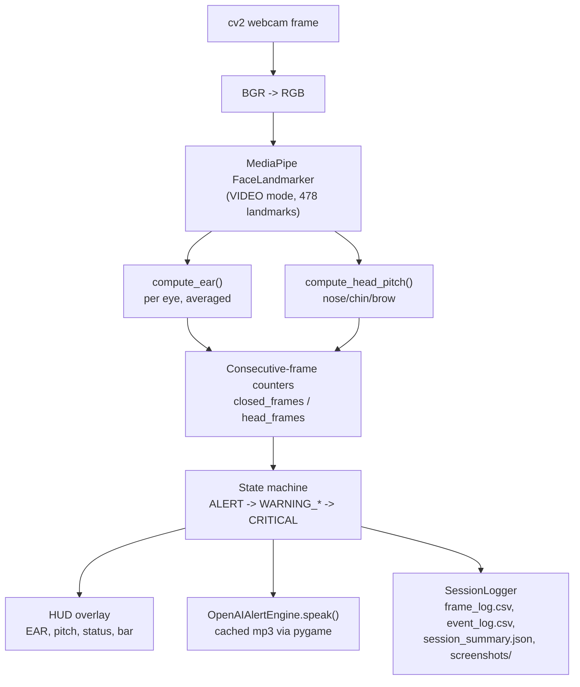

# AlertEye

A real-time driver drowsiness detector that watches eye closure (EAR) and head pitch through a webcam, escalates through warning states, and speaks alerts out loud via OpenAI TTS. Built on MediaPipe's Face Landmarker and OpenCV.

> This is a local desktop script (webcam + on-screen HUD + spoken alerts) — there's no hosted web demo to link to; run it locally per the instructions below.

## How it works

- **Eye closure** — Eye Aspect Ratio (EAR) computed from 6 landmarks per eye (`EAR_THRESHOLD = 0.22`); a blink is a brief dip, drowsiness is a *sustained* dip.
- **Head pitch** — angle derived from nose/chin/brow landmark depth and vertical spacing (`HEAD_PITCH_THRESH = 15.0°`); a sustained tilt beyond this means the head is dropping.
- Both signals are tracked as **consecutive-frame counters** (`closed_frames`, `head_frames`), not single-frame flags, so one bad frame never triggers an alert — only sustained closure/drop does.
- Escalation is frame-count based: `WARNING_FRAMES = 20` frames of sustained closure/drop → a warning state; `CRITICAL_FRAMES = 40` → critical.
- Every state change speaks a pre-generated OpenAI TTS alert (`tts-1`, voice `nova`) through `pygame`, cached to disk on first run so playback has no API latency.
- A full session log is written per run: per-frame CSV, per-transition event CSV, a JSON summary, and a HUD screenshot on every state change.

## State machine



## Pipeline: webcam frame to alert



## Installation

```bash
pip install opencv-python mediapipe numpy scipy openai pygame
```

Set your OpenAI key (used only for TTS alert generation) as an environment variable or paste it into `OPENAI_API_KEY` at the top of `drowsiness_detect_tts.py` — **do not commit a real key to this file**.

The MediaPipe face landmarker model (`face_landmarker.task`, ~30 MB) is downloaded automatically on first run.

## Usage

```bash
python drowsiness_detect_tts.py
```

On first run, all alert phrases are pre-generated as mp3s into `alert_audio_cache/` (one-time OpenAI TTS cost), then the webcam opens with the live HUD. Each run writes a new `session_<timestamp>/` folder with the full frame/event logs and screenshots described above.
